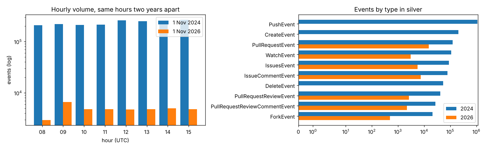

# A medallion lakehouse on GH Archive with PySpark, and the upstream change it caught

[](https://colab.research.google.com/github/Ashhar-Hussain/gharchive-spark-lakehouse/blob/main/gharchive_spark_lakehouse.ipynb)
   

[GH Archive](https://www.gharchive.org/) publishes every public GitHub event as hourly gzipped JSON. This project builds a small lakehouse on it, **raw → bronze → silver → gold**, with idempotent incremental loads and a **data contract** that decides what may be published.

The contract earns its keep on real data. The same eight hours of 1 November 2024 and 1 November 2026 look like two different datasets:

| | 2024 batch | 2026 batch |
|---|---:|---:|
| events (8 hours) | 1,870,675 | 38,471 (-97.9%) |
| `PushEvent`, `CreateEvent`, `DeleteEvent` | present | **absent** |
| `pull_request.merged` / `additions` in PR payloads | present | **absent** |
| new event types | – | `DiscussionEvent` |

14 of 21 contract checks fail on the 2026 batch, so the pipeline still lands the raw truth in bronze and silver but **holds back** the gold tables that depend on the missing fields (`hourly_activity, repo_activity`) and publishes only `bot_share`. A pipeline without this check would quietly report merge rates and commit counts of zero.



## Pipeline

```
data.gharchive.org ──► raw/*.json.gz ──► bronze/ (dt, hr)  typed, partitioned Parquet, lineage columns, corrupt-record capture
                                          │
                                          ▼
                                      silver/ (dt, hr)  de-duplicated by event id, validated; failures → quarantine/ with a reason
                                          │   ◄── data contract (volume band, required types, payload fields, closed type list)
                                          ▼
                                      gold/   hourly_activity · repo_activity · bot_share   (published only if their inputs pass)
```

* **Idempotent loads**: dynamic partition overwrite; re-running the 2024 batch leaves bronze and silver at 1,870,675 rows.
* **Orchestration**: [`dags/gharchive_hourly.py`](dags/gharchive_hourly.py) runs the same steps hourly in Airflow (TaskFlow API, retries with back-off, contract-gated gold), using [`pipeline/lakehouse.py`](pipeline/lakehouse.py).

## What the optimisations buy (2 CPU cores)

| query | variant | seconds |
|---|---|---:|
| count by event type | raw gzip JSON | 7.42 |
| | bronze Parquet | 0.29 |
| distinct repositories | all 8 hour partitions | 0.69 |
| | 1 partition (pruned) | 0.28 |
| join with a type dimension | broadcast hash join | 0.53 |
| | sort-merge join | 0.80 |

Same gold query on three engines over the silver Parquet: Spark 0.45 s, DuckDB 0.05 s, Polars 0.04 s. At this size a single-node engine wins; Spark pays off when data or concurrency outgrow one machine.

## Run it

Colab badge above (Java and Spark are installed by the notebook; about 10 minutes, downloads ~0.8 GB), or locally with Java 17+:

```bash
pip install -r requirements.txt
jupyter nbconvert --to notebook --execute gharchive_spark_lakehouse.ipynb
```

## Repository

```
gharchive_spark_lakehouse.ipynb   pipeline walkthrough, contract, benchmarks (executed)
pipeline/lakehouse.py                bronze/silver/gold/contract functions used by the DAG
dags/gharchive_hourly.py             hourly Airflow DAG
outputs/                             figures, summary.json, findings.md
```

## Citation

```bibtex
@software{hussain2026gharchivesparklake,
  author  = {Hussain, Ashhar},
  title   = {A medallion lakehouse on GH Archive with PySpark, and the upstream change it caught},
  year    = {2026},
  url     = {https://github.com/Ashhar-Hussain/gharchive-spark-lakehouse},
  version = {1.0.0}
}
```

## License

Code: MIT. GH Archive data: MIT license (Ilya Grigorik).
